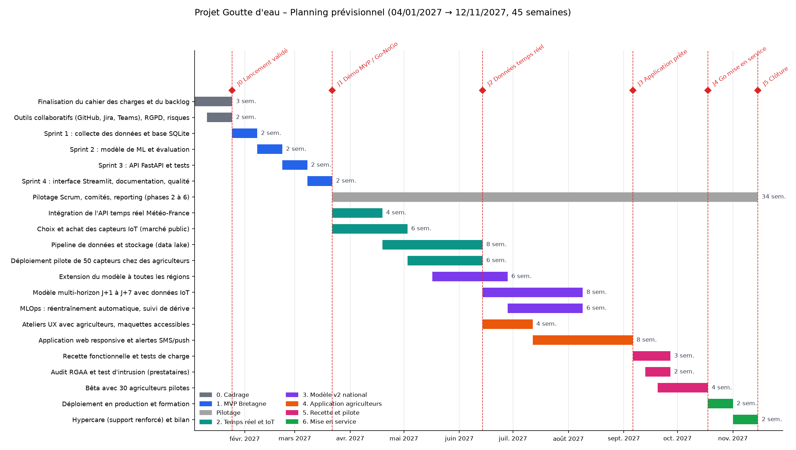

# Planification du projet Goutte d'eau

*Livrable 1 : méthode de gestion (C7), outils collaboratifs (C8), budget prévisionnel (C9) et schéma directeur (C10).*

Fichiers associés :
- [gantt.png](gantt.png) : diagramme de Gantt ;
- [budget_previsionnel.xlsx](budget_previsionnel.xlsx) : budget détaillé, avec formules modifiables ;
- [generer_planification.py](generer_planification.py) : script qui produit le Gantt et le budget à partir des mêmes données.

---

## 1. Rappel du périmètre

Le projet complet vise à **refondre la prévision des pluies de France Météo à destination des agriculteurs**,
en s'appuyant sur l'IA et sur des capteurs IoT. Il se déroule en 6 phases sur **45 semaines**,
du **4 janvier 2027 au 12 novembre 2027** :

| Phase | Objectif | Résultat attendu |
|---|---|---|
| 0. Cadrage | Finaliser le cahier des charges, organiser l'équipe | Backlog priorisé, outils en place |
| 1. MVP Bretagne | Prouver la faisabilité sur une région | Chaîne complète données → modèle → API → interface |
| 2. Temps réel et IoT | Alimenter le modèle en continu | API Météo-France temps réel + 50 capteurs pilotes |
| 3. Modèle v2 national | Passer à l'échelle | Toutes les régions, prévisions de J+1 à J+7, MLOps |
| 4. Application agriculteurs | Interface finale accessible | Application web responsive et alertes |
| 5. Recette et pilote | Valider qualité, sécurité et accessibilité | Bêta avec 30 agriculteurs, audits RGAA et sécurité |
| 6. Mise en service | Passer en production | Déploiement, formation, support renforcé |

> La phase 1 (MVP) est **déjà réalisée** : le code est dans ce dépôt. Elle sert de référence pour calibrer
> les durées des phases suivantes.

---

## 2. Méthode de gestion choisie (C7)

**Choix : une méthode hybride, avec un cadrage séquentiel puis un développement en Scrum.**

| Pourquoi pas un cycle en V seul ? | Pourquoi pas du Scrum seul ? |
|---|---|
| Un projet d'IA comporte une forte part d'incertitude : la qualité du modèle, la disponibilité des données ou la fiabilité des capteurs ne se connaissent qu'en expérimentant. Un cycle en V figerait trop tôt les spécifications. | France Météo est un établissement public : le budget doit être validé en amont, les achats de matériel IoT passent par un marché public et la mise en service a une date fixe. Ces contraintes demandent un cadrage et des jalons formels. |

Concrètement :
- **Phase 0 (cadrage), séquentielle :** cahier des charges validé, budget validé par la direction financière, gouvernance, outils.
- **Phases 1 à 5, en Scrum :** sprints de **2 semaines**. Chaque sprint produit un incrément démontrable.
- **Jalons de décision (J0 à J5) :** à chaque jalon, un comité de pilotage décide de continuer (Go/No-Go). Le jalon J1, à la fin du MVP, est le plus important : il conditionne l'engagement des phases suivantes, soit environ 85 % du budget.

### Rituels Scrum

| Rituel | Fréquence | Durée | Participants |
|---|---|---|---|
| Sprint planning | début de sprint | 2 h | Équipe, PO |
| Daily meeting | quotidien | 15 min | Équipe |
| Sprint review (démo) | fin de sprint | 1 h | Équipe, PO, expert météo, agriculteurs testeurs (dès la phase 4) |
| Rétrospective | fin de sprint | 1 h | Équipe |
| Comité de pilotage | mensuel et à chaque jalon | 1 h 30 | Direction, CP, PO |

### Définition de « terminé » (Definition of Done)

Une fonctionnalité n'est terminée que si :
- le code est relu (pull request validée) ;
- les tests passent ;
- la documentation est à jour ;
- les critères d'accessibilité sont respectés (pour l'interface) ;
- elle est déployée en préproduction.

### Organisation de l'équipe

| Rôle | Charge totale | Missions principales |
|---|---|---|
| Chef de projet / Scrum Master (CP) | 125 j | Planning, budget, animation Scrum, reporting au comité |
| Product Owner (PO) | 100 j | Besoins métier, priorisation du backlog, lien avec les agriculteurs |
| Data Scientist (DS) | 130 j | Modèles de prévision, évaluation, choix des variables |
| Data Engineer (DE) | 105 j | Collecte, nettoyage, base de données, pipeline temps réel |
| Développeur back-end (BE) | 77,5 j | API, alertes, intégrations |
| Développeur front / UX-UI (FE) | 76 j | Interfaces, ateliers UX, accessibilité |
| DevOps / MLOps (OPS) | 71 j | Infrastructure, CI/CD, mise en production, suivi des modèles |
| Ingénieur IoT (IOT) | 45 j | Choix, installation et intégration des capteurs |
| Testeur QA / accessibilité | 50 j | Recette, tests de charge, conformité RGAA |
| Expert prévisionniste (MET) | 43,5 j | Validation scientifique des modèles et des seuils |
| **Total** | **823 jours-homme** | |

### Matrice RACI (extrait)

R = réalise, A = valide (responsable final), C = consulté, I = informé.

| Livrable | CP | PO | DS | DE | BE | FE | OPS | MET |
|---|---|---|---|---|---|---|---|---|
| Cahier des charges | R | A | C | C | I | I | I | C |
| Base de données | I | I | C | R/A | C | I | C | I |
| Modèle de prévision | I | C | R/A | C | I | I | C | C |
| API | I | C | C | C | R/A | C | C | I |
| Application agriculteurs | I | A | I | I | C | R | C | I |
| Mise en production | A | C | C | C | R | R | R | I |

---

## 3. Outils de travail collaboratif (C8)

| Besoin | Outil | Paramétrage prévu |
|---|---|---|
| Code source et versions | **GitHub** (offre Team) | Branche `main` protégée, une branche par fonctionnalité, pull requests avec relecture obligatoire, modèles d'issues |
| Intégration continue | **GitHub Actions** | Tests automatiques (`pytest`) et contrôle qualité du code à chaque pull request |
| Backlog et sprints | **Jira Software** (ou GitHub Projects pour le MVP) | Tableau Scrum, épics par phase, user stories avec critères d'acceptation, graphique d'avancement (burndown) |
| Documentation | README et `docs/` dans le dépôt, avec un wiki | Documentation versionnée avec le code |
| Communication | **Microsoft Teams** (déjà déployé chez France Météo) | Un canal par phase, un canal alertes CI, visioconférences des rituels |
| Suivi des modèles | **MLflow** (phase 3) | Historique des entraînements, métriques et versions de modèles |

---

## 4. Schéma directeur (C10)

### Jalons

| Jalon | Date | Critère de passage |
|---|---|---|
| **J0** Lancement validé | 22/01/2027 | Cahier des charges et budget validés par la direction |
| **J1** Démo MVP / Go-NoGo | 19/03/2027 | MVP fonctionnel, ROC AUC > 0,70 et meilleur que les références naïves |
| **J2** Données temps réel | 11/06/2027 | Flux Météo-France et 50 capteurs remontant des données exploitables |
| **J3** Application prête | 03/09/2027 | Modèle v2 national et application terminés |
| **J4** Go mise en service | 15/10/2027 | Recette validée, audit RGAA et pentest sans anomalie bloquante, retours de bêta positifs |
| **J5** Clôture | 12/11/2027 | Fin de l'hypercare, bilan de projet, passage en maintenance |

### Détail des étapes

**Phase 0 : Cadrage (S1–S3, 04/01 → 22/01/2027)**
- Finalisation du cahier des charges : besoins des agriculteurs (horizon de prévision utile, seuils agronomiques, canaux d'alerte), contraintes RGPD (données de localisation des exploitations), backlog initial priorisé.
- Mise en place des outils (section 3), analyse des risques, validation du budget.

**Phase 1 : MVP Bretagne (S4–S11, 4 sprints, 25/01 → 19/03/2027) ✅ réalisée**

| Sprint | Contenu | Livrable |
|---|---|---|
| 1 | Choix de la source (SYNOP Météo-France), collecte de 10 ans de données, nettoyage, base SQLite | `goutte/collect.py`, `goutte/database.py` |
| 2 | Variables explicatives, comparaison de 3 modèles légers face à 2 références, évaluation | `goutte/train.py`, `docs/evaluation.md` |
| 3 | API FastAPI (risque de pluie selon la date), tests automatisés | `goutte/api.py`, `tests/` |
| 4 | Interface Streamlit, indicateurs qualité, documentation | `app/streamlit_app.py`, `README.md` |

**Phase 2 : Données temps réel et IoT (S12–S23, 22/03 → 11/06/2027)**
- Bascule de l'archive SYNOP vers l'API temps réel Météo-France (portail-api.meteofrance.fr).
- Achat de 50 stations connectées. La procédure de marché public de 6 semaines est lancée dès le début de la phase.
- Pipeline de données (ingestion toutes les heures, contrôle qualité automatique, stockage) et déploiement des capteurs chez des agriculteurs volontaires.

**Phase 3 : Modèle v2 national (S20–S31, 17/05 → 06/08/2027)**
- Extension à toutes les régions (un modèle par zone climatique).
- Prévision sur plusieurs horizons (J+1 à J+7), en intégrant les mesures IoT.
- MLOps : réentraînement automatique mensuel, alerte en cas de dérive des performances.
- Les modèles restent légers (forêts d'arbres, gradient boosting), sans deep learning, par sobriété.

**Phase 4 : Application agriculteurs (S24–S35, 14/06 → 03/09/2027)**
- Ateliers avec des agriculteurs, puis maquettes conçues accessibles dès le départ (RGAA).
- Application web responsive (mobile d'abord) et alertes SMS ou notifications : « risque élevé de pluie demain sur votre parcelle ».

**Phase 5 : Recette et pilote (S36–S41, 06/09 → 15/10/2027)**
- Recette fonctionnelle et tests de charge.
- Audit d'accessibilité RGAA et test d'intrusion, réalisés par des prestataires externes.
- Bêta de 4 semaines avec 30 agriculteurs pilotes.

**Phase 6 : Mise en service (S42–S45, 18/10 → 12/11/2027)**
- Déploiement en production, formation des équipes support et webinaires pour les agriculteurs.
- 2 semaines de support renforcé (hypercare), puis bilan et passage en maintenance.

> **Congés d'été :** les phases 3 et 4 couvrent juillet et août. Leurs durées (8 semaines pour les tâches
> principales) intègrent une baisse de capacité d'environ 20 % sur cette période.
>
> **Chevauchements volontaires :** la phase 3 démarre (S20) avant la fin de la phase 2, car l'extension
> aux autres régions n'a pas besoin des capteurs IoT. De même, les ateliers UX de la phase 4 commencent
> dès que le format des prévisions est stabilisé.

---

## 5. Budget prévisionnel (C9)

Le budget est calculé directement depuis le planning : charge de chaque tâche × taux journalier
de chaque rôle (TJM). Le détail et les hypothèses modifiables sont dans
[budget_previsionnel.xlsx](budget_previsionnel.xlsx).

| Poste | Montant (€ HT) |
|---|---|
| Ressources humaines (823 jours-homme) | 487 825 € |
| Matériel IoT (50 stations, connectivité, installation) | 41 800 € |
| Hébergement cloud (hébergeur français bas carbone) | 6 200 € |
| Outils collaboratifs (GitHub, Jira) | 1 320 € |
| Prestations externes (audit RGAA, pentest) | 20 000 € |
| Conduite du changement (formation, agriculteurs pilotes) | 12 000 € |
| **Total avant aléas** | **569 145 €** |
| Provision pour aléas (10 %) | 56 915 € |
| **BUDGET TOTAL** | **626 060 € HT** (751 271 € TTC) |

### Coût RH par phase

| Phase | Coût RH | Part |
|---|---|---|
| 0. Cadrage | 33 750 € | 6,9 % |
| 1. MVP Bretagne | 63 450 € | 13,0 % |
| Pilotage (phases 2 à 6) | 87 550 € | 17,9 % |
| 2. Temps réel et IoT | 93 500 € | 19,2 % |
| 3. Modèle v2 national | 86 400 € | 17,7 % |
| 4. Application agriculteurs | 70 500 € | 14,5 % |
| 5. Recette et pilote | 34 175 € | 7,0 % |
| 6. Mise en service | 18 500 € | 3,8 % |

**Coût de fonctionnement annuel après mise en service** : environ **90 800 € HT par an**. Il comprend l'hébergement de production, la connectivité et la maintenance des capteurs, et une maintenance applicative estimée à 15 % du coût de développement.

**Maîtrise des coûts :**
- engagement par étapes : seuls la phase 0 et le MVP (environ 97 000 € de RH) sont engagés avant le Go/No-Go J1 ;
- un modèle léger et un hébergement sobre limitent les coûts d'infrastructure ;
- les données Météo-France sont gratuites (licence ouverte Etalab) ;
- la provision pour aléas n'est utilisée qu'avec l'accord du comité de pilotage.

---

## 6. Risques principaux

| Risque | Probabilité | Impact | Mesure de réduction |
|---|---|---|---|
| Performances du modèle insuffisantes | Moyenne | Fort | Go/No-Go J1 sur des critères chiffrés, comparaison systématique à des références naïves |
| Retard du marché public des capteurs | Moyenne | Moyen | Procédure lancée dès S12, le modèle v2 peut d'abord tourner sans IoT |
| Indisponibilité ou changement de l'API Météo-France | Faible | Fort | Couche de collecte isolée (un module), cache local, source de secours (Infoclimat) |
| Faible adoption par les agriculteurs | Moyenne | Fort | Ateliers UX et bêta avec 30 agriculteurs avant la mise en service |
| Non-conformité RGAA ou faille de sécurité | Faible | Fort | Accessibilité prise en compte dès les maquettes, audits externes avant J4 |
| Départ d'un membre clé | Faible | Moyen | Documentation dans le dépôt, relecture croisée du code |
